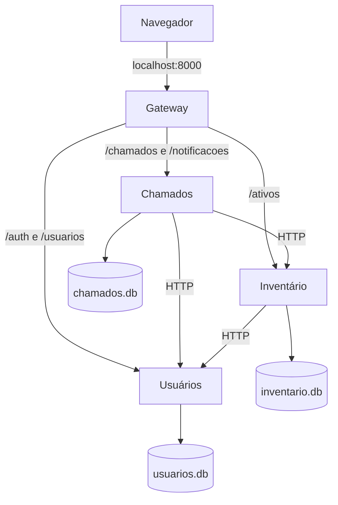

# HelpDesk TI · microsserviços

Sistema de chamados de TI (no estilo de um GLPI simplificado), feito em **Python + FastAPI**.
O projeto foi separado em três serviços e um gateway como parte da atividade de **Arquitetura de Software**. [Enunciado do desafio](DESAFIO.md)

##Video no drive##
https://drive.google.com/file/d/1c7gJuGb4ePdKa3Ti6Xl7IouL18skh-rM/view?pli=1

## Histórico da migração

- Preparação, Usuários e Inventário. [ETAPA_04.md](ETAPA_04.md)
- Extração de Chamados. [ETAPA_05.md](ETAPA_05.md)
- Integração do gateway, interface e Docker Compose. [ETAPA_06.md](ETAPA_06.md)
- Validação de segurança, integração e indisponibilidade. [ETAPA_07.md](ETAPA_07.md)

## Telas do sistema

As imagens foram registradas na versão original do projeto.


| Login | Painel do técnico | Chamado resolvido |
|---|---|---|
|  |  |  |

## O que o sistema faz

- **Login** com e-mail e senha; cada pessoa vê e faz só o que o seu perfil permite.
- Cadastra **usuários** e **equipamentos** (inventário de TI).
- **Abre chamados** com prioridade e calcula o prazo de atendimento (SLA): crítica 4 h, alta 8 h, média 24 h, baixa 72 h.
- **Atribui** chamados a técnicos, controla o **status** e aceita **comentários**.
- Registra **notificações** quando um chamado é aberto, atribuído ou resolvido.
- Mostra um **painel** com totais por status e chamados atrasados.

### Perfis e permissões

| Ação | Solicitante | Técnico | Administrador |
|---|:-:|:-:|:-:|
| Abrir chamado | ✅ | ✅ | ✅ |
| Ver chamados | só os seus | todos | todos |
| Comentar | nos seus | todos | todos |
| Atribuir e resolver | ❌ | ✅ | ✅ |
| Fechar ou reabrir um chamado resolvido | os seus | ✅ | ✅ |
| Cadastrar equipamentos | ❌ | ✅ | ✅ |
| Cadastrar usuários | ❌ | ❌ | ✅ |

## Como rodar

Copie `.env.example` para `.env` se ainda não tiver um arquivo local. Defina um `JWT_SEGREDO` com pelo menos 32 caracteres. Se o contêiner do monólito estiver em execução, pare-o para liberar a porta 8000:

```powershell
docker compose -f docker-compose.monolito.yml stop helpdesk
```

Na raiz, inicie o gateway e os três serviços:

```powershell
docker compose up --build
```

Com `DADOS_EXEMPLO=1`, Usuários e Inventário criam suas contas e ativos de aula no primeiro início. Para preencher uma base vazia de Chamados, aguarde os serviços e rode em outro terminal:

```powershell
docker compose exec -T chamados python -m app.dados_exemplo
```

Depois abra:

- Tela do HelpDesk: http://localhost:8000
- Documentação da API (Swagger): http://localhost:8000/docs (clique em **Authorize** e cole o token do login)

Para consultar a versão original, pare o gateway com `docker compose stop gateway` e rode `docker compose -f docker-compose.monolito.yml up --build`. O monólito usa seu volume original.

### Contas de acesso

Não é preciso criar conta: o sistema já começa com estes usuários.
Todos usam a senha **`Helpdesk2026`**.

| E-mail | Perfil | O que pode fazer |
|---|---|---|
| `admin@empresa.com` | Administrador | Tudo, inclusive cadastrar usuários |
| `carla@empresa.com` | Técnica | Ver todos os chamados, atribuir, resolver e cadastrar equipamentos |
| `diego@empresa.com` | Técnico | O mesmo que a Carla |
| `ana@empresa.com` | Solicitante | Abrir chamados e ver só os próprios |
| `bruno@empresa.com` | Solicitante | O mesmo que a Ana |

Dicas:

- Para testar o fluxo completo (abrir, atribuir, resolver e fechar), entre como **Carla**.
- Para testar as permissões, entre como **Ana**: ela não vê os chamados do Bruno.
- Para trocar a senha de todas as contas, defina `SENHA_EXEMPLO` no arquivo `.env`.
- As contas só são criadas quando o sistema sobe com `DADOS_EXEMPLO=1` (o padrão), e só na primeira vez, com o banco vazio.

> Estas contas têm senha conhecida e servem só para aula. Em produção, use `DADOS_EXEMPLO=0`.

### Configuração

Copie `.env.example` para `.env` e ajuste. O principal é o `JWT_SEGREDO`, que assina os logins.
O arquivo `.env` nunca deve ir para o GitHub (ele já está no `.gitignore`).

## Testes

```bash
pytest -q
```

A suíte na raiz cobre o monólito. Para testar os projetos independentes, instale o `requirements-dev.txt` e execute `python -m pytest -q` dentro de `gateway/` ou do serviço correspondente em `servicos/`. O GitHub Actions executa as suítes em jobs separados e roda o `pip-audit`.

Para verificar a integração real, rode na raiz com o Docker em execução:

```powershell
python -m pip install -r integracao/requirements.txt
python -m pytest -q -c integracao/pytest.ini integracao/tests
```

A suíte sobe seu próprio projeto Compose, com credenciais, porta temporária e volumes exclusivos. Ela simula as quedas de Inventário e Usuários e remove os recursos daquele projeto ao terminar. O roteiro para a demonstração manual está em [ROTEIRO_VIDEO.md](ROTEIRO_VIDEO.md).

## Segurança

Veja o que está protegido e o que fazer antes de usar em produção em [SECURITY.md](SECURITY.md).

## Arquitetura atual

O gateway é o único contêiner com porta publicada. Usuários, Inventário e Chamados rodam em processos independentes, com um volume SQLite para cada serviço. As chamadas entre serviços passam pela rede do Docker.



```
gateway/              # Interface e proxy HTTP
servicos/
├── usuarios/         # Login, perfis e usuários
├── inventario/       # Equipamentos
└── chamados/         # Chamados, comentários e notificações
app/                  # Monólito original
```

## Rotas principais

Todas exigem login, exceto `/auth/login` e `/saude`.

| Método | Rota | O que faz | Quem pode |
|---|---|---|---|
| POST | `/auth/login` | Entra e recebe o token | Todos |
| GET | `/auth/eu` | Dados de quem está logado | Logado |
| POST | `/usuarios` | Cria usuário | Admin |
| GET | `/usuarios` | Lista usuários (sem e-mail) | Logado |
| POST / GET | `/ativos` | Cria e lista equipamentos | Técnico e admin / logado |
| POST | `/chamados` | Abre chamado em nome de quem está logado | Logado |
| GET | `/chamados` | Lista chamados | Logado (solicitante vê só os seus) |
| GET | `/chamados/painel` | Totais por status e atrasados | Logado |
| PATCH | `/chamados/{id}/atribuir` | Atribui a um técnico | Técnico e admin |
| PATCH | `/chamados/{id}/status` | Muda o status | Técnico e admin (solicitante: fechar ou reabrir) |
| POST | `/chamados/{id}/comentarios` | Comenta no chamado | Envolvidos |
| GET | `/notificacoes` | Minhas notificações | Logado |
